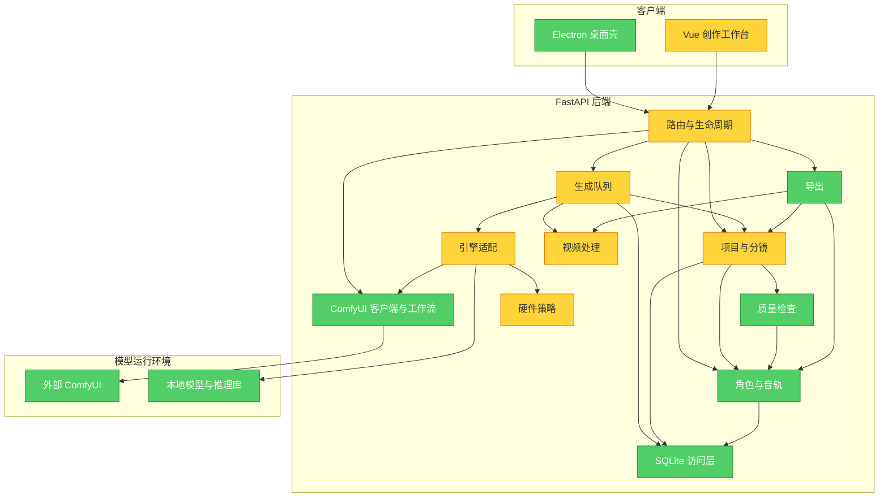

# FreeVideo 对标与后续改造建议

日期：2026-10-20。审查基线：`d4187ba866ace58f41f1f1adda7c01b500713c69`。

建议继续把产品做成「面向多镜头创作的 AI 视频工作台」：优先补齐生成输入、预览升级和素材复现，再接入 FreeVideo 本地推理，随后完善角色一致性与长片段制作。已有的项目、分镜、审核、剪辑和桌面壳可以继续使用。

## 当前基线与参考范围

- 当前分支：`hotfix/p0-comfy-robustness`；本地 `main`、`origin/main` 跟踪引用和 HEAD 均为 `d4187ba`。这是本地引用核对，本轮没有 fetch，不能据此断言远端服务器此刻的状态。
- `v040`、`v080` 报告中的「main 尚未包含开发线修复」已不符合当前本地引用；后续排期不要再把旧缺口全部重做。
- 已有实现：ComfyUI prompt_id 持久化与恢复、待核查状态、任务产物隔离、受管路径、上传唯一命名、首尾帧、角色数据快照、版本对比、工作流缺节点/缺模型检查、导出帧率参数化。
- FreeVideo 参考对象为 **FlashML-org/FreeVideo**。本轮查到的发布页最新版本为 **v0.4.16**。官方已提供分段长视频、局部重生成及接缝预览；这些比仅模仿四档质量更值得借鉴。[发布说明](https://github.com/FlashML-org/FreeVideo/releases/tag/v0.4.16)
- 本轮为源码审查、隔离逻辑复现和现有测试执行；没有执行真实 GPU 推理、在线 ComfyUI 联调或 Electron 原生窗口验收。

## Brooks-Lint Review

**Mode:** Architecture Audit  
**Scope:** 全仓库模块边界；重点抽查后端生成/素材/快照/导出、Vue 生成与镜头编辑、Electron 生命周期。排除模型、生成产物和依赖目录。  
**Health Score:** 60/100（8 项 Warning；按本次抽查风险扣分，不代表可用率或模型效果）  
**Trend:** First run — no trend data

已有的可靠性修复可以保留；主要风险集中在多个入口对生成参数和素材条件的解释不一致。

### Module Dependency Graph

以下为逻辑模块依赖，合并展示低风险叶模块；颜色只反映本轮发现。

### Findings

#### Warning

**W1 — Domain Model Distortion：界面输入模式与实际推理能力不完全对应**

Symptom: `engines/base.py` 允许不支持的引擎忽略图片参数；`engines/wan.py:160`、`engines/anime.py` 的生成路径实际忽略参考图。分镜路由仅对 ComfyUI 做模式能力校验，因此选择本地引擎仍能提交图生、首尾帧或续接。另外，`routers/storyboard.py:343–555` 中 i2v 虽认可独立 `first_frame_image`，构建工作流时却只沿用 `reference_image`，没有把独立首帧归一化到实际输入。

Source: Evans — *Domain-Driven Design*, Ubiquitous Language；Martin — *Clean Architecture*, Liskov Substitution Principle。

Consequence: 用户选择的图片条件可能不参与生成；即使任务完成，也不等于执行了所选模式。

Remedy: 给各引擎提供可执行的能力声明；所有入口在备料前校验模式。统一首帧输入后，再按真实工作流映射上传；不支持的组合明确拒绝。

证据：隔离调用 i2v，仅设独立首帧、模板映射 `reference_image`，上传调用次数为 **0**，最终 LoadImage 输入为 **空字符串**。这是逻辑链路复现，没有调用真实模型。

**W2 — Knowledge Duplication：普通生成与分镜生成的参数规则分叉**

Symptom: `routers/jobs.py:38` 会处理质量档、显式参数与 `PREVIEW_OVERRIDE`；`routers/storyboard.py:317` 接收同名 `preset/preview` 后直接保存 `model_dump()`，没有执行相同归一化。`quality.py` 里虽有共用函数，分镜入口没有使用。

Source: Hunt & Thomas — *The Pragmatic Programmer*, DRY；Fowler — *Refactoring*, Duplicate Code。

Consequence: 同一档位在不同入口有不同含义；标记为预览的分镜任务也可能按普通参数执行。当前前端手工填参掩盖了部分接口问题。

Remedy: 提取共用的请求归一化函数，两个入口都使用；针对具体引擎输出最终有效参数，保存请求值与实际值。

证据：隔离提交分镜 `engine=wan22, preset=fine, preview=true`，落库仍为 **512×512 / 16 帧 / 25 步**，并非 `PREVIEW_OVERRIDE` 的 **416×256 / 17 帧 / 12 步**。

**W3 — Change Propagation：工作流快照缺失仍可能改变排队任务语义**

Symptom: `routers/storyboard.py:579` 写快照失败后继续入队；`engines/comfy.py:221` 在已指定快照路径但文件不存在时，允许读取当前模板重建。现有 schema/sha256 校验保护的是「文件存在」路径。

Source: Ousterhout — *A Philosophy of Software Design*, Information Hiding and Leakage；Winters et al. — *Software Engineering at Google*, Hyrum's Law。

Consequence: 排队期间改模板，再遇到快照写入失败或文件被清理，任务可能执行另一份工作流；已有校验不能覆盖这种情况。

Remedy: 新任务必须先完成可恢复的快照存储，再进入可执行状态。明确区分旧格式无快照任务与新格式快照丢失任务；后者进入待处理状态。文件可原子写入，并用数据库记录准备状态；不要假设文件与 SQLite 能天然构成同一事务。

证据：向 `_resolve_workflow()` 传入明确但不存在的快照路径，返回了当前模板 B 的节点图。

**W4 — Domain Model Distortion：角色快照尚未形成视觉一致性输入闭环**

Symptom: `assets.py:158` 只拼接外貌和服装描述；分镜入队会保存 `reference_images/lora`，但 `routers/storyboard.py` 构建工作流没有注入这两项。保存角色字段不等于推理执行时使用了它们。

Source: Evans — *Domain-Driven Design*, Domain Model；Fowler — *Refactoring*, Feature Envy。

Consequence: 历史角色数据可追溯，但跨镜头换脸、换装问题仍可能存在；不能依据当前实现承诺稳定角色一致性。

Remedy: 为实际支持的工作流增加多参考图和 LoRA 映射，冻结素材内容哈希、模型标识、权重和输入角色。未接入的能力在界面标明。沿用已有角色快照，先补「从某历史角色快照生成」，再决定是否需要独立角色版本表。

**W5 — Domain Model Distortion：升级渲染与视频携带参数尚不等于完整复现**

Symptom: `GalleryView.vue:88` 的 upgrade 仅带回 engine/prompt/negative/preset/seed，跳转通用生成页；缺少原镜头、参考图、角色快照、来源版本和工作流关联。`queue_manager.py` 的 `_job_metadata()` 写入常规参数，没有完整节点图、素材清单或模型指纹。Wan 当前升级路径也没有保存并继续使用第一遍 latent。

Source: Evans — *Domain-Driven Design*, Ubiquitous Language；Hunt & Thomas — *The Pragmatic Programmer*, Orthogonality。

Consequence: 升级可能脱离原镜头，或用到新模板/新角色；同 seed 不能保证改分辨率和帧数后构图保持不变。单独拷走 MP4 也不能还原完整运行输入。

Remedy: 增加基于来源任务/版本的升级操作，保留素材与工作流来源，只更新目标质量参数；记录父子任务关系。把「同 seed 重新生成高清候选」和引擎原生「继续二采」区分展示。补导出/导入 manifest 或项目包，默认排除 API Key 等凭据。

**W6 — Knowledge Duplication：硬件推荐尚未形成按任务规划与反馈闭环**

Symptom: `hw_probe.py:121` 按总容量、compute capability 和固定阈值推荐 Wan 模型、量化及 offload，耗时来自公式估计；`packaging/launcher.py` 另有安装决策。未见按每次请求几何尺寸、实时空闲显存、可用物理内存、内核探测和历史实测共同规划的链路。

Source: Hunt & Thomas — *The Pragmatic Programmer*, DRY；Winters et al. — *Software Engineering at Google*, Dependency Management。

Consequence: 可安装与可完成当前请求容易混为一谈；其他程序占显存、量化失败回退和切换常驻模型后，实际内存需求与界面建议可能不同。

Remedy: 分开安装计划与运行计划，运行前重新取资源预算；记录实际使用的精度、卸载策略、阶段耗时和峰值。接入 FreeVideo 时优先调用其能力，不把其 H3 专用阈值直接复制给 Wan。[FreeVideo 执行规划说明](https://github.com/FlashML-org/FreeVideo/blob/main/docs/execution-planning.md)

**W7 — Dependency Disorder：视频子进程文本解码依赖启动入口的环境**

Symptom: `video.py:44` 等 `subprocess.run(..., text=True)` 没有显式编码；当前 Windows 默认编码下，含中文提示词的 FFmpeg 输出触发 GBK 解码异常，随后 `read_video_metadata()` 因 stdout 为 None 报错。launcher/Electron 设置了 UTF-8，`start.bat` 则没有同等保护。

Source: Feathers — *Working Effectively with Legacy Code*, Sensing and Separation；Ousterhout — *A Philosophy of Software Design*, Information Hiding。

Consequence: exe、源码启动和测试的行为可能不同；中文视频元数据读回会失败。

Remedy: 在 FFmpeg 适配边界明确处理字节解码、退出码和 stderr，避免依赖 shell 全局编码。元数据使用 UTF-8 严格读写；日志可单独容错，避免靠替换字符掩盖参数损坏。

证据：全量测试 **2 failed / 176 passed / 1 skipped**，两项失败均位于中文元数据读回；设置 `PYTHONUTF8=1` 后仅复跑这两项，**2 passed**。这说明存在入口环境依赖，不代表源码已经修复。

**W8 — Cognitive Overload / Testability：生成编排与全局依赖增加后续改动成本**

Symptom: 分镜生成路由约 280 行，承担素材抽帧、角色拼装、能力探测、上传、节点注入、快照、落库及排队；`storyboard.py` 为 1245 行，`ProjectView.vue` 为 1229 行。测试 fixture 为隔离数据库，需要同时替换 db 单例及三个业务模块的绑定。引擎结果还通过 `last_native_video/last_prompt_id` 实例字段传递。

Source: McConnell — *Code Complete*, High-Quality Routines；Feathers — *Working Effectively with Legacy Code*, The Seam Model。

Consequence: 新增多参考图或原生二采时，容易再次在入口、执行与存档之间形成差异；增加并发前，结果副作用和全局单例也需要重新审视。

Remedy: 随 PR-A/B 抽出生成准备服务和任务结果对象，让路由只负责协议与调度。为数据库和引擎执行器建立两个明确注入点；按分镜、版本审核、时间线职责渐进拆分现有大文件。当前单 GPU 串行队列可保留，不以增加 worker 数量作为提速手段。

### 补充检查

- AST 扫描发现 `assets → storyboard → assets` 的文本级相互导入，但前一条来自 `delete_character()` 内未使用的局部导入；不据此声称当前存在加载死循环。
- 路由和应用入口承担编排，高 fan-out 本身不作为违规；SQLite 适合当前单机产品，暂未发现必须改成分布式数据库或消息队列的证据。
- 未获知团队分工，Conway's Law 检查跳过。
- 测试替换基础设施的能力已存在；建议收敛现有替换点，而非引入完整依赖注入框架。

### Summary

先统一生成输入和快照语义，可以减少后续所有模型接入的返工。现有分镜与资产管理是继续建设的基础，下一轮应把「选了什么、实际用了什么、如何恢复与复用」做成可验证的闭环。

## 与 FreeVideo 的能力对照

| 方向 | 当前软件 | 后续重点 |
|---|---|---|
| 项目与多镜头创作 | 已有剧本、分镜、审核、角色卡、时间线 | 保留主流程，补材料缺失提示与下一步操作 |
| 本地 FreeVideo 推理 | 内置 MiniMax 模板声明 `paid_api`，属于外部 API 节点模板；没有内置 FreeVideo 本地预设 | 基于官方实际工作流和 `/object_info` 接入，独立命名和版本管理；现有付费模板需单独联调 |
| 首尾帧 | 已有双图、快照和模板映射检查 | 补各引擎能力限制、i2v 输入归一化、实际消费检查 |
| 角色一致性 | 已冻结角色字段 | 把角色图和 LoRA 真正送入支持的模型，增加效果验收 |
| 预览后继续 | 已有轻量参数与升级按钮 | 保留全部来源；支持原生二采的引擎才显示继续二采 |
| 低显存 | Wan 基于 torchao、offload、VAE tiling | 按任务测量、记录实际策略与峰值；FreeVideo 采用独立适配 |
| 长视频/局部重做 | 已有镜头续接、来源版本、过期提示、级联返工 | 补镜头依赖图、分段恢复、版本分支和接缝前后预览 |
| 视频复现 | 已写常规参数，节点图存本地快照 | 补素材/模型 manifest、跨机器导入与缺项报告 |
| 安装与发布 | 已有 launcher、Electron 和更新逻辑 | 依赖版本组合可复现、复用模型目录、下载校验与失败恢复 |

FreeVideo 官方定位是 H3 本地推理与创作集成，并采用专门的权重流式加载、预取和请求规划；其最低资源声明不能直接用于当前 Wan 实现。[官方说明](https://github.com/FlashML-org/FreeVideo)

## 建议按六批实施

以下是增量 PR 划分，不重复沿用旧报告中已完成的编号。

| 批次 | 优先级 | 主要改动 | 完成条件 |
|---|---|---|---|
| PR-A 生成契约与兼容性 | P0 | 共用 preset/preview 归一化；各引擎模式矩阵；修 i2v 独立首帧；统一 FFmpeg 编码处理 | 两个入口得到同样的有效参数；不支持模式在入队前拒绝；两张不同图能验证映射；GBK/UTF-8 环境均可读回中文参数 |
| PR-B 快照与升级 | P0 | 新任务快照准备完成再入队；区分旧任务与快照丢失；升级绑定来源任务/版本；保留工作流与资产快照 | 改模板、改角色后升级仍使用原输入；快照丢失明确待处理；升级候选留在原镜头，原版本保留 |
| PR-C FreeVideo 本地适配 | P1 | 从选定版本官方工作流导出 API 图；读取实机节点能力；新增本地预设与模型检查；记录运行版本与资源 | 指定版本 ComfyUI + FreeVideo 上真实完成 t2v/i2v；费用标识准确；取消、断线恢复和原生视频归档有效 |
| PR-D 角色视觉约束 | P1 | 多参考图/LoRA 输入映射；资产哈希；角色快照重用；展示实际采用的约束 | 节点图可证明消费了图片和权重；三镜头同角色人工对比验收；修改角色后历史版本输入保持不变 |
| PR-E 镜头链与成片 | P1/P2 | 分段依赖关系、局部重做分支、接缝前后各两秒预览；导出冻结视频版本、剪辑、音轨、字幕与参数清单 | 中间段失败只恢复该段；重做不覆盖旧片；导出期间编辑项目不改变该次清单；成片音画、字幕和帧率实测通过 |
| PR-F 性能与交付 | P2 | 每任务资源预算与实测历史；模型切换释放策略；评估独立推理进程；锁定已验证依赖组合；模型目录复用 | 低显存/切换模型/推理进程失败有可解释结果；公布固定配置的耗时与峰值；安装和升级可重复验证 |

PR-C 可在 PR-A/B 边界稳定后开展技术验证；不应把所有 P1/P2 功能一次性塞入同一改造。

建议的 UI 增量：

1. 沿用现有首页与侧边栏，在镜头旁显示「缺首帧/缺节点/缺模型/可以生成/等待审核」及对应动作。
2. 生成前显示执行位置、输入条件、有效分辨率/帧数、质量档位和预计资源；高级参数收起。
3. 预览、正式候选、采用版本和已导出版本分别可见；升级时直接显示来源与变化项。
4. 现有并排 A/B 视频补同步播放与同时间定位；续接镜头补接缝预览与继承过期解释。
5. 失败提示提供具体阶段和可执行恢复动作，保留当前 prompt_id 对账与待核查机制。

AI 导演继续放在这些基础能力之后。届时由规划器调用经过验证的剧本、镜头、生成、审核和导出操作，复用现有数据模型。当前项目计划也将这部分列为后置工作；本轮没有实施它。

## 本轮验证记录

| 检查 | 结果 |
|---|---|
| 前端 `npm run build` | 通过，56 modules transformed |
| 桌面测试 | `node --test --test-isolation=none tests/runtime.test.js tests/shell-ui.test.js`：18 passed |
| 默认桌面测试命令 | Node 测试隔离子进程被沙箱 `spawn EPERM` 阻断；关闭测试进程隔离后完成同一组测试，未声称执行了 Electron 原生 GUI |
| 后端全量 | 隔离库与工作区临时目录下：176 passed / 2 failed / 1 skipped，139.62 秒 |
| 两个失败项 | `test_remux_video_copy_preserves_stream_and_metadata`、`test_queue_native_video_passthrough`：FFmpeg UTF-8 内容被按 GBK 解码，stdout 为 None |
| 失败项对照复跑 | 新 Python 进程设置 `PYTHONUTF8=1`：2 passed / 18 deselected；未修改生产代码 |
| 输入/快照复现 | 分镜 preview/preset 未归一化；i2v 独立首帧未注入；指定快照丢失读取当前模板，三项均复现 |
| GPU/ComfyUI/安装包 | 本轮未验收，不沿用旧报告的通过记录作为本轮实测证据 |

首次后端测试在加载 fixture 时因默认数据库路径无法打开而中止；随后显式指定工作区内隔离数据库与临时目录完成全量运行。临时诊断数据位于 git 忽略的 `.phase1/freevideo-audit-20261020/`，未使用业务数据库。

本轮交付审查与排期文档，没有修改业务源代码，也没有合并、提交或发布代码。
